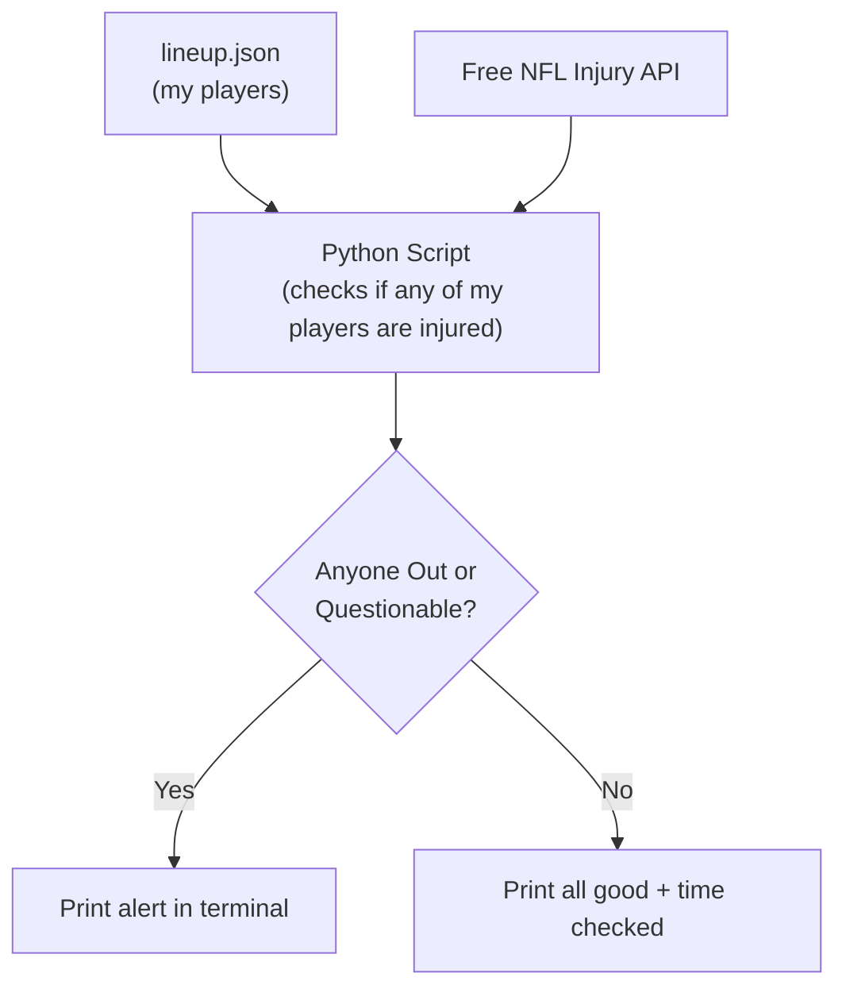

#System Diagram

### How it works
- `lineup.json` just holds the list of players on my fantasy team.
- The script uses `requests` to grab the latest injury report from a free NFL API.
- It loops through my players and checks if any of them show up as injured or inactive.
- If someone is out, it prints a warning in the terminal so I know to swap them before kickoff.